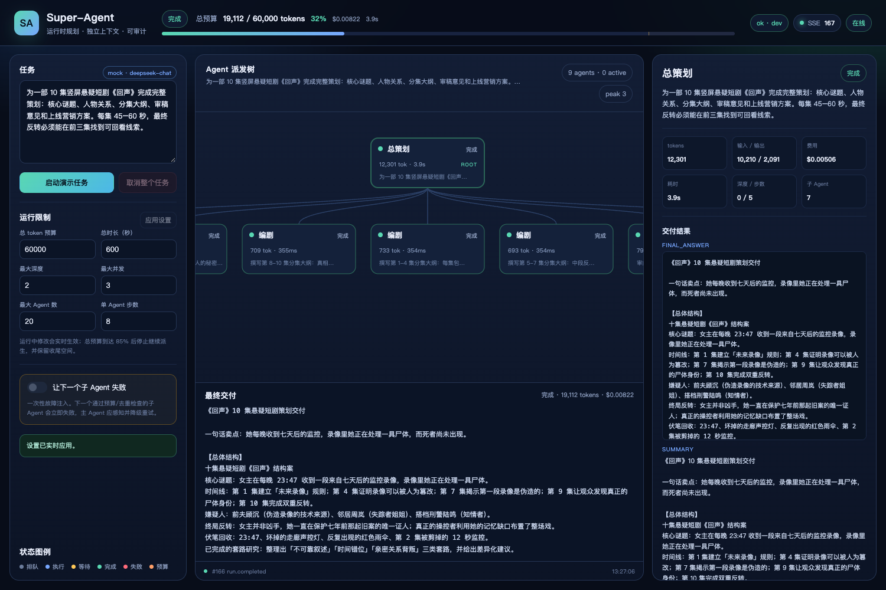
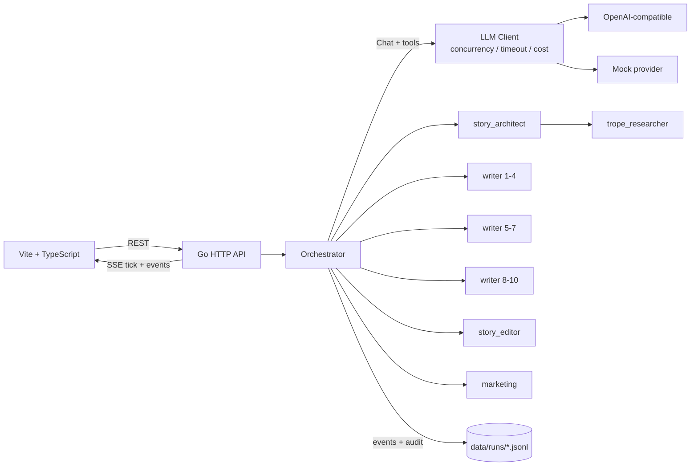
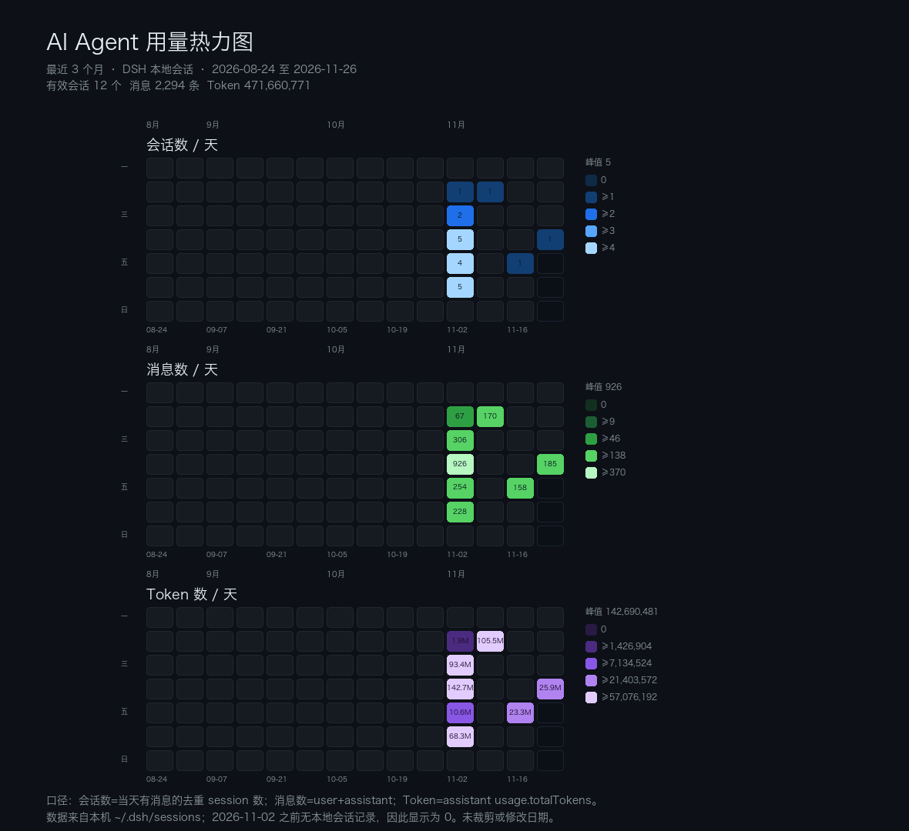

# Super-Agent 多智能体编排系统

一个**运行时动态规划**的多智能体系统：主 Agent 根据中间结果决定下一步，通过
`spawn_agent(role, task, context)` 派生拥有独立上下文的子 Agent，并统一执行预算、
深度、并发、去重、失败恢复、取消和全程审计。

演示任务固定为「10 集竖屏悬疑短剧《回声》策划」，但编排逻辑不依赖该任务，计划不是
静态 JSON，而是由模型在每一轮工具结果之后决定。



---

## 1. 交付速览

| 必做项 | 实现 |
| :--- | :--- |
| 后端 `/health` | Go 标准库，`GET /health` 与 `/api/health` |
| Vite + TypeScript 前端调用后端 | 前端读取 `/health`、`/api/config`、SSE 与任务 API |
| 一条命令同时启动前后端 | `make dev`（Go :8080 + Vite :5173） |
| 每秒递增序号实时消息 | SSE `/api/stream`，全局 `id` 序号，1s tick，断线按 `Last-Event-ID` 补发 |
| 大模型封装、token/费用记录、并发上限 | `internal/llm`，OpenAI 兼容 + 离线 mock，全局信号量 |
| 完整工具调用闭环 | `spawn_agent` / `finish` / `submit_result`，tool result 回传模型后继续 |
| 主 Agent 动态派发、多子 Agent 并发 | 同一轮多个 `tool_calls` 并发执行，父 Agent 等待并读取结果 |
| 总 token/时间预算、子 Agent 步数上限 | 软阈值 + 硬停止 + 收尾保留 + 部分交付 |
| 深度/并发/重复派发防护 | 深度检查、可调 Gate、结构化去重键 |
| 失败处理 | 失败注入、超时、API 错误、空结果、不合格结果、有限重试 |
| 上下文隔离 | 子 Agent 只收到结构化任务包，不收到父对话 |
| 全链路记录 | 事件 JSONL、Agent 消息、工具 trace、模型调用账目 |
| 树形图、节点对话、预算、调试面板 | 见截图；预算/深度/并发可运行中修改，支持失败注入和取消 |

选做的**单 Agent 对照**已实现（`max_depth=0`，同一任务），数据见第 12 节。黑板共享记忆未实现。

---

## 2. 快速开始

### 2.1 前置条件

- Go **1.23+**（开发机验证于 Go 1.25.5）
- Node.js **20+**
- pnpm **9+**（开发机验证于 pnpm 11.28.5）
- 可选：Docker + Docker Compose

### 2.2 一条命令启动

```bash
cp .env.example .env      # 可选；默认 mock 不需要 key
make dev
```

打开 **http://127.0.0.1:5173**。

`make dev` 会：

1. 定位 Node/pnpm（支持系统安装或 `NODE_BIN`/`PNPM_JS` 指定）；
2. 首次运行时安装前端依赖；
3. 编译并启动 Go 服务（:8080）；
4. 启动 Vite（:5173），代理 `/health` 与 `/api`；
5. Ctrl-C 同时终止两个进程。

### 2.3 其他命令

```bash
make test       # go vet + go test ./... + tsc --noEmit + vite build
make build      # 构建 web/dist 和 bin/server
make run        # 生产模式：Go 单进程托管 API + 静态前端，:8080
make clean
docker compose up --build   # 容器模式，:8080
```

生产模式下 Go 直接托管 `web/dist`；`WEB_DIR=web/dist` 是默认值。容器内为
`WEB_DIR=/app/web`。

### 2.4 接入真实模型

默认 `LLM_PROVIDER=mock`，无需网络即可完整演示。接入任意 OpenAI 兼容接口：

```dotenv
LLM_PROVIDER=openai
LLM_BASE_URL=https://api.deepseek.com
LLM_API_KEY=sk-...
LLM_MODEL=deepseek-chat
LLM_MAX_CONCURRENCY=4
LLM_INPUT_USD_PER_MTOK=0.27
LLM_OUTPUT_USD_PER_MTOK=1.10
```

API key 只放在本地 `.env`，`.gitignore` 已排除。仓库只有 `.env.example`，不含任何密钥。

> 说明：当前开发环境没有可用的真实模型 key，因此没有执行线上付费调用。OpenAI 兼容
> 请求/工具调用解析已用 `httptest` 覆盖；填入 key 后走同一代码路径。默认 mock 也是
> 真实的工具循环，只是不访问网络。

---

## 3. 现场演示脚本

| 步骤 | 操作 | 预期 |
| :--- | :--- | :--- |
| 1 | 点击「启动演示任务」 | SVG 树从根节点逐步展开：总策划 → 架构/人物 → 编剧×3/审稿/营销，架构下还有类型研究，共 9 个节点 |
| 2 | 点击任意「编剧」节点 | 右侧只显示该子 Agent 的系统提示、任务包、自身消息与 tool trace；不含父对话或兄弟上下文 |
| 3 | 打开「让下一个子 Agent 失败」 | 下一个子 Agent 立刻红色失败；主 Agent 收到 `forced_failure`，以「降级重试」缩小范围重派，最终仍有交付（实测 10 节点） |
| 4 | 把总 token 预算改为 1800，应用/启动 | 到 85% 后拒绝继续派生，硬停止后输出确定性「部分交付」；状态 `budget_exhausted` |
| 5 | 最大深度设为 1，启动新任务 | 深度 1 的 Agent 不再拿到 `spawn_agent`，`trope_researcher` 不会出现，树的最大深度为 1 |
| 6 | 运行中点击「取消整个任务」 | 运行上下文取消；所有节点进入终态，状态 `cancelled`，可查看已完成节点的部分汇总 |

浏览器自动化已验证上述 6 条路径，详见第 11 节。

---

## 4. 架构



目录：

```text
cmd/server/                 Go 入口、优雅关闭
internal/config/            .env 加载与校验
internal/api/               /health、SSE、Runs/Agent/调试 API、静态托管
internal/orchestrator/      运行时规划、spawn、预算、并发、深度、去重、取消、审计
internal/llm/               OpenAI 兼容客户端、mock、并发/超时/费用封装
internal/stream/            全局递增序号事件 Hub + 历史补发
web/                        Vite + TypeScript（SVG 树 / 详情 / 调试面板）
scripts/                    dev/test 启动脚本
ai-logs/                    完整 AI 会话、trace、用量热力图
Dockerfile / docker-compose.yml
```

关键设计：**编排层不执行静态 DAG**。每一轮只把当前消息和可用工具给模型；模型返回的
tool calls 被执行、结果写回消息，再由模型决定下一轮。因此失败、预算变化、子任务结果
都会改变后续计划。

---

## 5. 实时链路：`/health` 与 SSE

### `/health`

```bash
curl http://127.0.0.1:8080/health
# {"status":"ok","service":"super-agent-orchestrator","version":"dev",...}
```

前端启动即调用 `/health`，之后每 30 秒复查一次，顶部显示 `ok · dev`。

### SSE

`GET /api/stream` 返回 `text/event-stream`：

```text
id: 1
event: tick
data: {"seq":1,"type":"tick","at":"...","data":{"interval_ms":1000}}
```

- 全局序号由同一个 `Hub` 分配，tick 与编排事件共用，严格单调递增；
- 每秒一条 `tick`；
- 编排事件包括 `run.created`、`agent.started`、`tool.result`、`llm.call`、`run.completed` 等；
- `id` 可作为 `Last-Event-ID` 重连，Hub 保留最近 4096 条事件补发；
- 慢客户端会被断开而不是静默丢事件，重连后补发；
- 前端显示 SSE 序号，并用事件触发 80ms 防抖刷新，3 秒轮询兜底。

---

## 6. 大模型封装与工具闭环

### 6.1 能力

`internal/llm` 对上层暴露统一 `Provider` 与 `Client`：

- **并发上限**：一个 run 共享一个容量为 `LLM_MAX_CONCURRENCY` 的信号量，等待槽位也响应 ctx 取消；
- **超时**：每次调用独立 `LLM_TIMEOUT_SECONDS`，超时会记录错误并返回；
- **token/费用**：每次调用记录 input/output/total、模型、耗时、并发数、finish reason、错误；
- **价格**：`input/1e6 * 输入单价 + output/1e6 * 输出单价`，价格可配置；
- **provider**：`mock` 与 `openai`（任何兼容 `/chat/completions` 的服务）。

每个 `CallRecord` 同时写入 Agent 的 `calls`、Run 的汇总和 `data/runs/<id>.jsonl`，前端右侧
「模型调用记录」逐条展示。

### 6.2 工具闭环

1. 请求携带 `tools`（`spawn_agent`/`finish`/`submit_result`）；
2. 模型返回 `tool_calls`；
3. 编排器并发执行工具，把结果作为 `role:"tool"` 消息追加到该 Agent 自己的消息；
4. 再次调用模型，直到 `finish`（主）或 `submit_result`（子）；
5. 子 Agent 的 `submit_result` 通过参数校验（summary/artifact/self_check）才算合格；
6. 不合格时把错误作为 tool result 回传，让子 Agent 修正；超过步数上限则失败并由父 Agent 决定后续。

工具执行与模型调用都写入 trace；`spawn_agent` 的 tool result 只包含
`summary/artifact/tokens/duration`，不包含子 Agent 的消息。

### 6.3 mock

`mock` 是确定性 provider，仍走完整工具循环：

- 主 Agent 先并行派发 `story_architect` 与 `character_designer`；
- 架构师再派生 `trope_researcher`，形成深度 2；
- 之后并行派发 3 个编剧；审稿、营销；
- 子 Agent 用 `submit_result` 提交真实风格的策划内容；
- 强制失败时可看到「降级重试」。

它让评审无需 key 就能复现所有编排行为。

---

## 7. 编排器规则与实现

### 7.1 配置

| 设置 | 默认 | 作用 |
| :--- | ---: | :--- |
| `max_tokens` | 60000 | run 总 token 预算 |
| `max_duration_sec` | 600 | run 总时长 |
| `max_depth` | 2 | 根为 0；默认允许子、孙 |
| `max_concurrency` | 4 | 同时运行的 Agent 上限 |
| `max_agents` | 20 | run 内 Agent 总数（含根） |
| `agent_max_steps` | 8 | 单个 Agent 的模型调用步数 |

调试面板在运行中 PATCH 设置；`max_concurrency` 会立即调整 Gate，`max_depth` 会影响之后
所有 spawn，时间/预算变化会在 200ms 监控周期内生效。

### 7.2 `spawn_agent`

```json
{
  "role": "writer",
  "task": "撰写第 1-4 集分集大纲",
  "context": {
    "goal": "10 集悬疑短剧《回声》策划",
    "facts": ["已确认 23:47 的未来录像规则"],
    "upstream": ["总体结构：...", "人物关系：..."],
    "constraints": ["每集 45–60 秒", "结尾必须有钩子"]
  }
}
```

`role` 限定为已知角色；`context` 四个字段必须存在，逐项限制长度，JSON 总长度默认不超过
`SPAWN_CONTEXT_MAX_CHARS=6000`。超过时工具调用被拒绝，子 Agent 根本不会创建。

### 7.3 主 Agent system prompt 设计

完整文本在 `internal/orchestrator/prompts.go`。核心不是「你是编剧」，而是定义**编排者契约**：

```text
【上下文边界】
1. 你只能看到本 system 消息、你的任务，以及 user 消息中的结构化任务包。
2. 你看不到父 Agent 的完整对话，也看不到兄弟 Agent 的私有上下文。
3. 派生新 Agent 时只能传目标、必要事实、上游结论和约束，绝对不要粘贴对话记录。
4. 缺少信息时标注假设，不要编造已经发生的事实。

【你的工作方式】
1. 先做运行时规划：哪些工作必须独立完成、哪些可以并行、哪些必须等待上游。
2. 可以在同一轮返回多个 spawn_agent，系统会并发执行。
3. 每一轮读取工具结果，根据成功/失败/预算动态决定下一步，不假设子 Agent 一定成功。
4. 子 Agent 失败且可重试时，换更小的任务或降级角色重派，不无限重试。
5. 预算不足时停止派生，调用 finish 提交已有成果并说明缺口。
6. 最终必须调用 finish。
```

实际 prompt 还注入了当前深度、最大深度、步数上限、总预算、工具错误修正规则和
`(role, task, context)` 去重提醒，并在末尾带 `[[role:showrunner]]` 供 mock 识别。

### 7.4 子 Agent 角色定义

| role | 定位 | 交付要求 |
| :--- | :--- | :--- |
| `story_architect` | 故事架构师 | 总体谜题、时间线、10 集钩子、嫌疑人、最终反转；可派生类型研究 |
| `character_designer` | 人物设计 | 核心人物、关系网、秘密、动机与行为矛盾 |
| `writer` | 编剧 | 分配集数的冷开场、3 个情节点、结尾钩子、伏笔 |
| `story_editor` | 审稿 | 逻辑/节奏/伏笔/一致性/可拍性，评分 + 必须修改项 |
| `marketing` | 营销 | 卖点、3 条短视频钩子、发布节奏、互动转化 |
| `trope_researcher` | 类型研究 | 套路与同质化风险，差异化建议（默认在深度 2） |

子 Agent 的 system prompt 只包含角色职责、统一上下文边界、交付契约和「是否还能派生」。
子 Agent 的 user prompt 只有 `task + JSON 任务包`，没有父对话。

### 7.5 上下文隔离

- 主 Agent 的 tool result 只拿到子 Agent 的 summary/artifact，不拿到它的 messages；
- 子 Agent 的 messages 只由自己的 system + task packet + 自己的 assistant/tool 消息组成；
- `AgentDetail.messages` 可在 UI 中完整查看，用于现场证明「它有什么、没有什么」；
- 任务包字段有硬上限：goal ≤500、facts ≤12×300、upstream ≤8×500、constraints ≤8×200；
- 全包 ≤6000 字符（可配），防止把整个上下文压缩后塞给子 Agent。

### 7.6 预算策略

采用「**软阈值 + 在途预留 + 硬停止 + 确定性收尾**」：

1. **软阈值 85%**：达到后不再创建新 Agent，返回 `budget_low`，主 Agent 应转入汇总；
2. **在途预留 300 token/子 Agent**：创建时计入 `Reserved`，结束释放，避免并发瞬间全部放行；
3. **调用级限制**：每次模型调用按剩余预算设置 `max_tokens`，上限 2048；
4. **硬停止**：监控器每 200ms 检查，`used ≥ max_tokens` 或超时即取消 run context；
5. **部分交付**：如果主 Agent 来不及 finish，系统用已完成节点的 summary 生成确定性
   `【部分交付】`，绝不编造未完成内容；
6. **时间预算**：`context.WithTimeout` + 监控器双保险，状态 `timed_out`。

**取舍**：并发中的模型调用无法在 token 产生前精确截断，因此实际值可能比硬上限高出一个
在途调用的量。小预算压测（1,800）最终为 2,065（115%），状态为 `budget_exhausted`，并
输出部分交付；默认 60,000 预算下实测多 Agent 任务为 19,112（32%），不会触发。README
明确记录这一点，而不是声称硬上限绝对精确。

### 7.7 防失控

| 机制 | 实现 |
| :--- | :--- |
| 深度限制 | 根深度 0；只有 `depth < max_depth` 的 Agent 才拿到 `spawn_agent` 工具；执行时再次检查 |
| 并发限制 | 可动态调整的 `Gate`；Agent 在等待子 Agent 时释放槽位，因此 `max_concurrency=1` 也不会嵌套死锁 |
| Agent 总数 | `max_agents` 含根，达到后拒绝并返回 `max_agents_reached` |
| 步数限制 | 每个 Agent 独立 `AgentMaxSteps`，超限 `step_limit` |
| 重复派发 | 去重键 `sha256(role + normalized_task + canonical_context)`；在途、已完成、同键第 2 次失败后均拒绝 |
| 死循环 | 去重 + 最大深度 + 最大 Agent 数 + 主 Agent 步数上限 + 总时长 |

去重对同一任务最多允许 **2 次**尝试（用于一次合法重试），之后返回 `duplicate_dispatch`。
失败注入的任务在 mock 中改用「降级重试」任务文本，因此键不同，但仍受 2 次上限保护。

### 7.8 失败处理

| 情况 | 代码 | 父 Agent 看到 | 默认策略 |
| :--- | :--- | :--- | :--- |
| 调试开关 | `forced_failure` | retryable=true | mock 主 Agent 缩小范围重派一次 |
| 模型 API 错误 | `llm_error` | retryable=true | 父 Agent 决定重试/降级 |
| 单次调用超时 | `timeout` | retryable=true | 同上；总时长到则 run `timed_out` |
| 不合格 submit | `invalid_result` | retryable=true | 子 Agent 先在自身步数内修正；仍不合格则失败 |
| 步数耗尽 | `step_limit` | retryable=false | 父 Agent 记录缺口，继续汇总其他分支 |
| 预算/深度/总数 | `budget_low` / `depth_exceeded` / `max_agents_reached` | retryable=false | 停止扩张，主 Agent finish 部分交付 |
| 重复派发 | `duplicate_dispatch` | retryable=false | 阻断循环 |
| 用户取消 | `run_cancelled` | retryable=false | 全树取消，保留已有结果 |

### 7.9 取消与终态

`Cancel` 写入 `stop_reason=user`，调用 run 的 cancel；所有 Agent 的 LLM 调用、Gate 等待、
子 Agent 等待都共享这个 ctx。每个 Agent 进入 `cancelled/failed/completed` 终态，Run 进入
`cancelled`，并由已完成节点生成部分汇总。调试面板的取消按钮调用同一接口。

状态集合：`queued/running/waiting/completed/failed/cancelled/timed_out/budget_exhausted`，
Run 额外有 `cancelling`。

### 7.10 全程记录

每个 run 在 `data/runs/` 下产生：

- `<run_id>.jsonl`：按 SSE 序号排列的所有事件，包括 `agent.created`、`agent.message`
  （完整输入/输出）、`tool.call`、`tool.result`、`llm.call`（含 token/耗时/费用）、状态迁移；
- `<run_id>.json`：结束时的完整 Run snapshot，包含树、token、费用、调用账目和 tool trace。

这些文件是运行数据，已在 `.gitignore` 中排除；AI 开发过程的会话记录单独放在 `ai-logs/`。

---

## 8. 演示页面

- **顶部**：Run 状态、总 token 预算条（带 15% 收尾保留区）、已用/上限、百分比、费用、耗时；
- **中间**：SVG 树。节点显示中文角色、状态、token、耗时、任务摘要；父子贝塞尔连线；
  根节点自动居中，超出宽度可横向滚动；点击/回车打开详情；
- **左侧**：任务输入、启动、取消、总预算/时长/深度/并发/最大 Agent/步数、应用设置、
  失败注入开关、状态图例；
- **右侧**：Agent 概览、token/cost/duration/depth/step、独立上下文任务包、完整消息
  （system/assistant/tool，含 tool calls）、逐次模型调用表、工具 trace、最终 artifact；
- **底部**：最近 SSE 事件、时钟；运行中每秒更新序号。

---

## 9. API

| 方法 | 路径 | 说明 |
| :--- | :--- | :--- |
| GET | `/health`, `/api/health` | 健康检查 |
| GET | `/api/config` | provider/model/默认设置/价格（不含 key） |
| GET | `/api/stream` | SSE，tick + 编排事件，支持 `Last-Event-ID` |
| POST | `/api/runs` | `{goal, settings}` 创建并异步启动 |
| GET | `/api/runs` | Run 列表 |
| GET | `/api/runs/{id}` | Run 树与预算快照 |
| GET | `/api/runs/{id}/agents/{agentID}` | Agent 独立上下文/消息/调用/trace |
| PATCH | `/api/runs/{id}/settings` | 完整 Settings 热更新 |
| POST | `/api/runs/{id}/fail-next` | `{enabled}` 一次性失败注入 |
| POST | `/api/runs/{id}/cancel` | 取消整个 run |

错误统一为 `{"error":{"code":"...","message":"..."}}`；已结束的任务返回 409。

---

## 10. 配置项

| 变量 | 默认 | 说明 |
| :--- | :--- | :--- |
| `PORT` / `ADDR` | `8080` / `:8080` | HTTP 监听 |
| `DATA_DIR` | `data` | 审计目录 |
| `WEB_DIR` | `web/dist` | 生产静态文件 |
| `LLM_PROVIDER` | `mock` | `mock` 或 `openai` |
| `LLM_BASE_URL` | `https://api.deepseek.com` | 兼容接口根地址 |
| `LLM_API_KEY` | 空 | 仅本地 `.env` |
| `LLM_MODEL` | `deepseek-chat` | 模型名 |
| `LLM_MAX_CONCURRENCY` | `4` | LLM 全局并发 |
| `LLM_TIMEOUT_SECONDS` | `90` | 单次调用超时 |
| `LLM_MAX_OUTPUT_TOKENS` | `2048` | 输出上限 |
| `LLM_INPUT_USD_PER_MTOK` | `0.27` | 输入单价 |
| `LLM_OUTPUT_USD_PER_MTOK` | `1.10` | 输出单价 |
| `MOCK_STEP_LATENCY_MS` | `350` | mock 模拟延迟 |
| `RUN_MAX_TOKENS` | `60000` | 默认总 token |
| `RUN_MAX_DURATION_SECONDS` | `600` | 默认总时长 |
| `RUN_MAX_DEPTH` | `2` | 默认深度 |
| `RUN_MAX_CONCURRENCY` | `4` | 默认 Agent 并发 |
| `RUN_MAX_AGENTS` | `20` | 默认总数 |
| `AGENT_MAX_STEPS` | `8` | 默认步数 |
| `SPAWN_CONTEXT_MAX_CHARS` | `6000` | 任务包上限 |

---

## 11. 测试与验证

```bash
make test
go test -race ./...
```

覆盖：

- **config**：默认值、非法值、`.env` 不覆盖进程环境、引号解析；
- **api**：`/health`、404、Run 生命周期、Agent 详情、参数校验、配置不泄 key、SSE 历史补发、
  生产静态文件；
- **stream**：序号递增、补发、并发唯一、ticker；
- **llm**：mock 两波派发、嵌套 architect 工具、OpenAI 兼容解析、401、并发上限、超时记账、
  费用公式；
- **orchestrator**：完整 9 节点树、深度 1、深度 0 单 Agent、失败注入重试、低预算部分交付、
  取消、并发=1 无死锁、重复派发、超大上下文拒绝；
- **前端**：`tsc --noEmit` + `vite build`；
- **浏览器实测**（Playwright + 本机 Chrome）：启动展开、点击子节点、失败注入、实时改并发、
  低预算、深度 1、取消；全部无 page error。

实测数据（mock，同一任务）：

| 场景 | 结果 |
| :--- | :--- |
| 完整多 Agent | 9 agents，19,112 tokens，$0.008225，3.9s，peak 3 |
| 失败注入 | 10 agents，1 个 failed + 1 个降级重试成功 |
| 低预算 1800 | 3 agents，2,065 tokens，`budget_exhausted`，部分交付 |
| 深度 1 | 8 agents，max depth=1，无类型研究节点 |
| 取消 | 4 agents，全部终态，`cancelled`，部分交付 |

---

## 12. 选做：单 Agent 对照

`max_depth=0` 时根 Agent 拿不到 `spawn_agent`，同一任务退化为单 Agent 一次性规划。
mock 在该模式输出完整的 10 集速览、人物与营销基线。

| 指标 | 单 Agent（深度 0） | 多 Agent（深度 2） |
| :--- | ---: | ---: |
| Agent 数 | 1 | 9 |
| 总 token | 737 | 19,112 |
| 费用 | $0.000411 | $0.008225 |
| 耗时 | 355ms | 3,894ms |
| 峰值并发 | 1 | 3 |
| 最终交付长度 | 497 字符 | 1,701 字符 |

**质量差异（定性）**：

- 单 Agent 覆盖谜题、人物、10 集速览和营销，但没有独立审稿、没有多编剧分工，时间线
  自检只能靠自己；适合低预算/快速草稿。
- 多 Agent 拆出架构、人物、3 个编剧、审稿和营销；审稿输出评分与 3 条必须修改项，
  分集钩子更细，上下文隔离使每个分支可以独立重试。
- 代价是约 26 倍 token、约 11 倍耗时。结论：**质量/可审计性要求高时用多 Agent；
  简单草稿用单 Agent 更经济**。

黑板共享记忆未实现，属于明确的选做留空项。

---

## 13. AI 会话记录与用量热力图

- 完整 DSH 会话：`ai-logs/session-*.jsonl`（原始解压 JSONL）与可读 Markdown；
- Tool trace：`ai-logs/trace-*.jsonl`（196+ 次工具调用的 name/args/result）；
- 导出方式、对应提交、脱敏说明：见 [`ai-logs/README.md`](ai-logs/README.md)。

**最近 3 个月用量热力图**（会话数 / 消息数 / Token，按天）：



口径与数据限制：DSH 本地会话，2026-08-24 至 2026-11-26；2026-11-02 之前没有本地
session 记录，因此显示为 0，不做补数；原始统计见
[`daily-usage.csv`](ai-logs/usage-heatmap/daily-usage.csv)。

---

## 14. 已知限制与取舍

1. **默认 mock**：评审不配 key 也能完整演示；真实模型费用/时延会不同。当前环境无 key，
   未执行真实付费调用。
2. **预算软硬结合**：并发在途调用可能让实际 token 略超硬上限，见 7.6；这是为了保留
   有用结果而做的明确取舍。
3. **运行态在内存**：进程重启后 Run 不能继续，但已落盘 JSONL 可用于审计。
4. **单实例、无鉴权**：定位是本地演示/评审系统，不面向公网多租户。
5. **Docker 配置已提供但本机未安装 Docker**：容器构建未实测；`make dev`/`make run` 已实测。
6. **黑板共享记忆未实现**：选做项留空，未用共享写入掩盖上下文隔离。
7. **热力图仅覆盖本机有记录的日期**：更早日期为 0，已在图注和 README 说明。

---

## 15. 提交

| 项目 | 填写 |
| :--- | :--- |
| 公开的 GitHub 仓库链接 | https://github.com/baiyideheimodao/super-agent-orchestrator |
| 最终 commit hash | `a3224ada27118455e214f6de99dbf7c9b80e19f9`（本表所在提交仅刷新 AI 日志） |
| 启动命令 | `make dev` |
| 使用的 AI 工具和模型 | DeepSeek Harness / `deepseek-flash` |
| 总用时（小时） | 约 0.7 |

### 提交前自查

- [x] 公开仓库，创建于写代码之前，首次提交仅 README
- [x] 完整项目，README 可运行，无密钥
- [x] 连续有意义提交，至少 8 次，无 force push/squash/rebase
- [x] `ai-logs/` 完整会话与 trace，含 README
- [x] 用量热力图覆盖最近 3 个月目录，并粘贴到 README
- [x] 截止前填写最终 commit hash 与总用时
